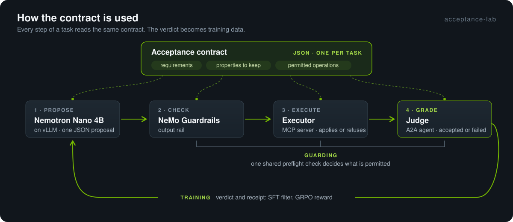

# acceptance-lab

An agent that repairs OpenUSD scenes, and a judge that grades each repair against a written
contract.

Each task has a scene and a contract. The contract is a JSON file. It lists the requirements (for
example, Y-up, meters, `/World` as the default prim), the properties that must not change, and the
operations the agent may use. The same contract has three uses:

1. **Grading.** A judge checks the repaired scene against each item in the contract.
2. **Guarding.** One preflight function decides which operations are permitted. The executor, the
   NeMo Guardrails rail and the judge all call it.
3. **Training.** The judge's verdict is the only label for fine-tuning and the only reward for
   reinforcement learning.

The model does not touch files. It sends one JSON proposal. The executor applies the proposal or
refuses it, and the judge reads the result.

This is a companion project to [stagewright](https://github.com/sushiHex/stagewright), which builds
OpenUSD scenes from prompts. stagewright makes scenes; this project checks an agent's changes to them.



[Results](#results) · [Technical guide](docs/guide.md) · [Quickstart](#quickstart)

## Results

The test split has 4 tasks that do not occur in training: a composite repair, a scene that needs no
change, an ambiguous orientation request that the agent must refuse, and an axis change that the
contract does not permit.

| Configuration | Accepted | Model success |
|---|---|---|
| Always abstain | 2/4 | |
| Scripted heuristic | 2/4 | |
| Nemotron Nano 4B on vLLM | 3/4 | 2/4 |
| + structured outputs | 3/4 | 2/4 |
| + SFT adapter | **4/4** | **4/4** |
| + GRPO adapter | 3/4 | 3/4 |

"Accepted" is the judge's grade. "Model success" is the training reward. It is lower when the
executor had to block an operation the model proposed.

- **SFT:** the model's own samples on the train split, kept only when the judge accepted them.
  The training epoch was selected on the dev split (17 tasks), where the adapter passes 16.
- **GRPO:** the judge's verdict is the reward. It passes 17 of 17 on dev. After five iterations
  almost all sampled groups got the same score, so the updates had no signal. On test it proposed
  a malformed operation on the composite task, and the executor blocked it.

**Example: change the contract, change the correct answer.** Task `demo-01` requires only
`up_axis: Z`. The scene is already Z-up, so the correct answer is no change. The SFT adapter refuses
the task instead, and the judge fails it. When `default_prim: /World` is added to the contract, the
correct answer becomes a repair. The same adapter sets the default prim, and all 12 checks pass. No
code changed between the two runs.

## Stack

| Stage | Tools |
|---|---|
| Model | Nemotron Nano 4B v1.1, served by vLLM with LoRA adapters |
| Proposer | LangChain `ChatOpenAI`, optional structured outputs, fastembed rule retrieval |
| Guard | NeMo Guardrails output rail that runs the shared preflight |
| Execute | MCP server, one process per attempt, OpenUSD (`pxr` from the OpenUSD Exchange SDK package) |
| Judge | A2A agent with read-only access to the task and the attempt |
| Train | LoRA SFT with PEFT, and GRPO with the judge as the reward |

## Verification

- 12 tests. Each test names the code change that must make it fail. `tools/mutate.py` makes those
  11 changes and confirms that a test fails each time.
- All 60 fixtures have a pass control and a fail control. The judge accepts every pass control and
  rejects every fail control.
- The train, dev and test splits do not overlap. The test task types (composite, ambiguous
  orientation, forbidden axis change) do not occur in train or dev. Dev selects the adapter. The
  results table uses test runs only.

Limits:

- The test split has 4 tasks, run once at temperature 0. The table shows a direction, not a
  statistically significant result.
- The check that a repair makes no unnecessary changes is approximate. The
  [guide](docs/guide.md#how-a-task-runs) gives the known gaps.
- All adapters fail `demo-01` as shipped.

## Quickstart

Windows, Python 3.13. The baselines do not need a GPU.

```powershell
git clone https://github.com/sushiHex/acceptance-lab.git
cd acceptance-lab
python -m venv .venv
.venv\Scripts\pip install -r requirements-windows.lock

.venv\Scripts\python run.py baseline            # both baselines, then runs/table.html
.venv\Scripts\python -m unittest test_lab -v    # tests
.venv\Scripts\python tools/controls.py          # pass and fail control for each fixture
```

The model configurations need vLLM in WSL Ubuntu and a 24 GB GPU. The
[technical guide](docs/guide.md#setup) covers setup, evaluation, training and the file layout.

[MIT](LICENSE) for the original code and fixtures. Dependencies keep their own licenses.
